# BUREAU

**The autonomous digital design bureau.** An agent skill that gives a language model the work of a whole studio: creative direction, art direction, typography, motion, creative technology, accessibility, performance, and an adversarial review that says *no*.

[](VERSION)
[](LICENSE)
[](#showcase)
[](#install)

[Português](README.md) · [English](README.en.md) · [Español](README.es.md) · [Documentation](https://acf1210.github.io/bureau/en/index.html) · [Live ShowCase](https://acf1210.github.io/bureau/showcase/index.html)

> **[Get started with BUREAU →](#install)**
>
> Choose your agent, install the skill, and turn a brief into a digital experience reviewed against evidence.
>
> [Explore the live projects](https://acf1210.github.io/bureau/showcase/index.html) · [Read the full workflow](docs/en/workflow.md)

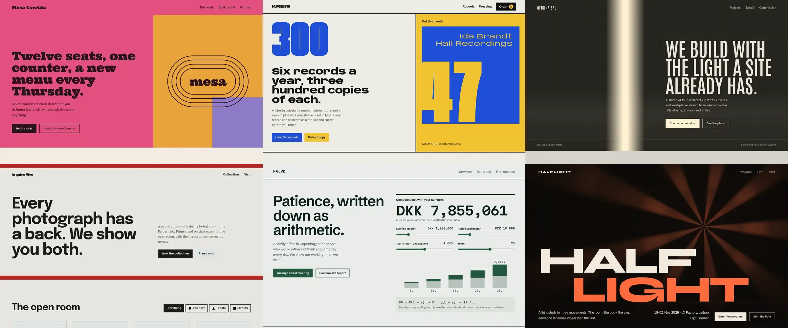

---

## The problem

Models learn the average of the internet. Without direction they ship the same centred hero, the same purple gradient, the same three icon cards and the same empty copy. CSS does not fix that. What is missing is **concept, specificity and review**.

- **Concept before pixels.** Three distinct directions, one argued choice, one signature move.
- **Never one source.** Every direction blends three documented designers, each owning one axis.
- **Verifiable craft.** Type, colour, composition, motion, access and performance with explicit thresholds and scripts that measure them.
- **Adversarial review.** Ten gates, a Delivery Gate with evidence on every line, and a Tribunal with a veto.
- **Zero fabrication.** A metric, logo, quote, award or "sent successfully" with nothing true behind it is a P0.

---

## ShowCase

Four web models, four fictional studios, each with a phone composition of its own: a mountain observatory, a perfume house, an ocean institute and a type foundry. Each model has a `LINEAGE.md` with its blend of three designers.

<!-- gallery:start -->
<table>
<tr>
<td width="72%" valign="top"><a href="https://acf1210.github.io/bureau/showcase/observatory/index.html">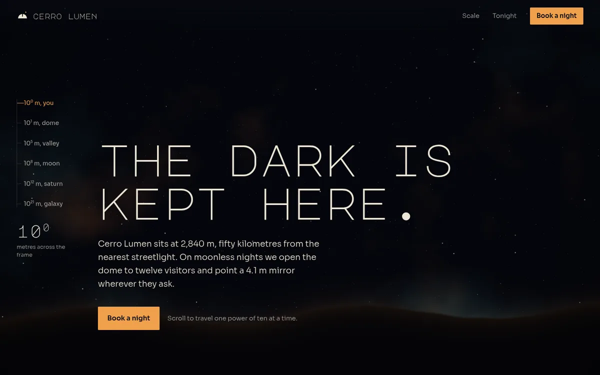</a></td>
<td width="28%" valign="top"><a href="https://acf1210.github.io/bureau/showcase/observatory/index.html">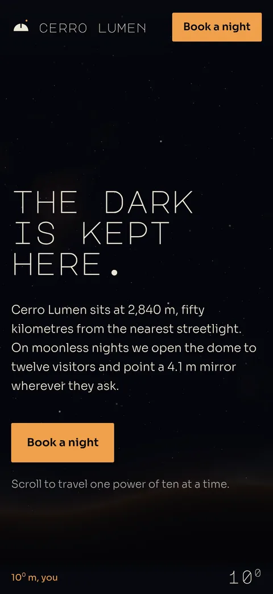</a></td>
</tr>
<tr>
<td colspan="2"><b>Cerro Lumen</b> · Mountain observatory · <sub>Gerstner × Moholy-Nagy × Eames</sub><br>Scroll from the dome to the galaxy, one power of ten at a time. <a href="https://acf1210.github.io/bureau/showcase/observatory/index.html">Open ↗</a></td>
</tr>
<tr>
<td width="72%" valign="top"><a href="https://acf1210.github.io/bureau/showcase/perfumery/index.html">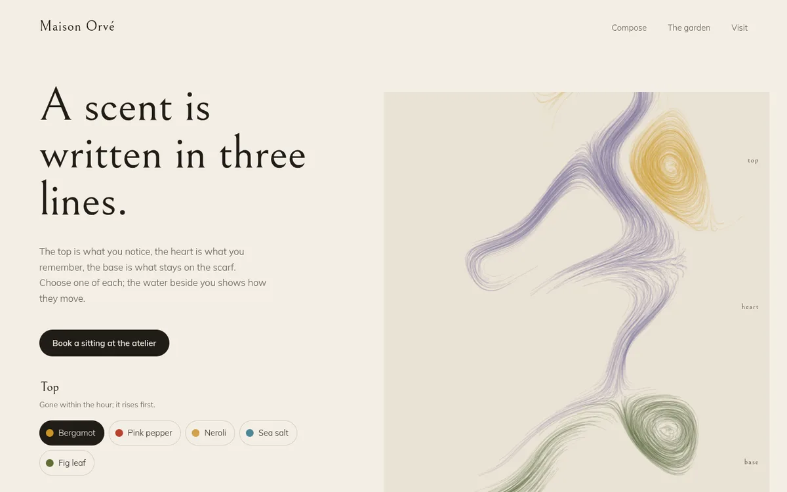</a></td>
<td width="28%" valign="top"><a href="https://acf1210.github.io/bureau/showcase/perfumery/index.html">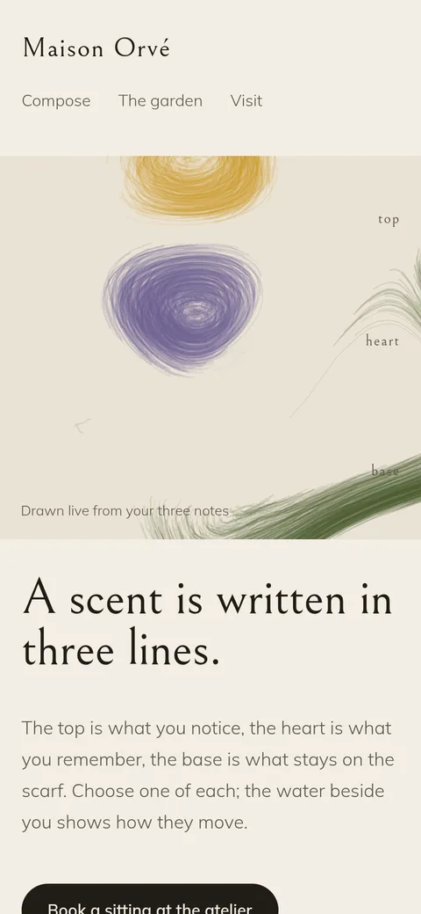</a></td>
</tr>
<tr>
<td colspan="2"><b>Maison Orvé</b> · Perfume house · <sub>Ruder × Greiman × Munari</sub><br>Compose top, heart and base; watch them move through water. <a href="https://acf1210.github.io/bureau/showcase/perfumery/index.html">Open ↗</a></td>
</tr>
<tr>
<td width="72%" valign="top"><a href="https://acf1210.github.io/bureau/showcase/ocean/index.html">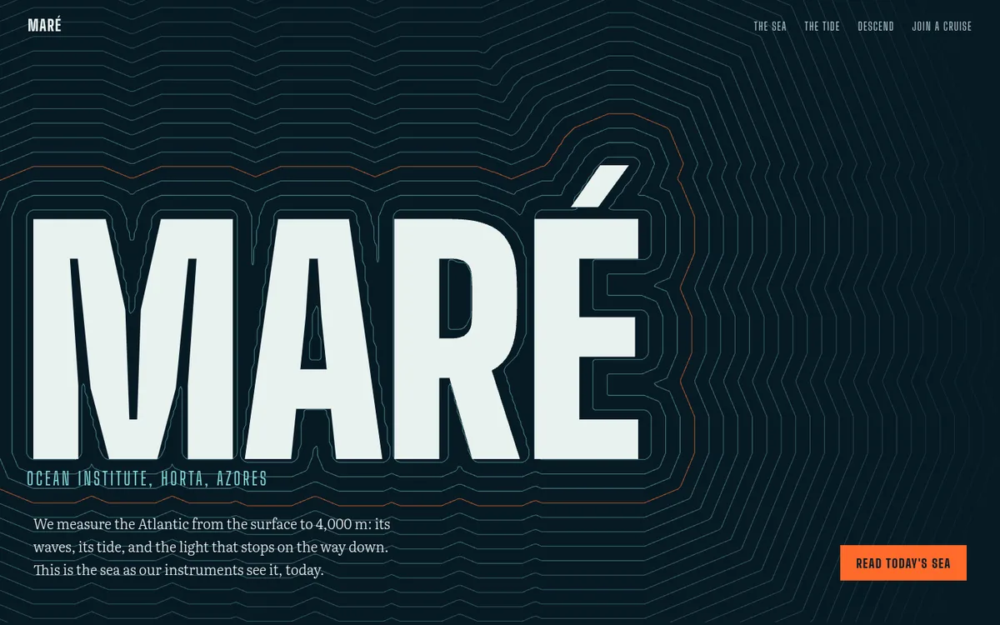</a></td>
<td width="28%" valign="top"><a href="https://acf1210.github.io/bureau/showcase/ocean/index.html">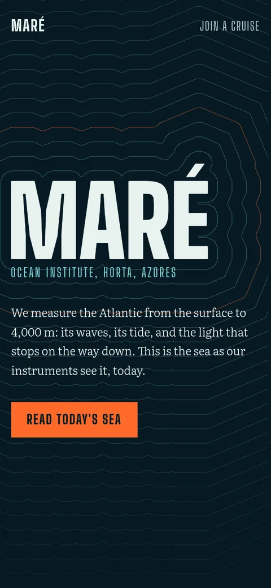</a></td>
</tr>
<tr>
<td colspan="2"><b>Maré</b> · Ocean institute · <sub>Sutnar × Wyman × Kare</sub><br>Contours radiate from the name; raise the wind and the sea builds. <a href="https://acf1210.github.io/bureau/showcase/ocean/index.html">Open ↗</a></td>
</tr>
<tr>
<td width="72%" valign="top"><a href="https://acf1210.github.io/bureau/showcase/foundry/index.html">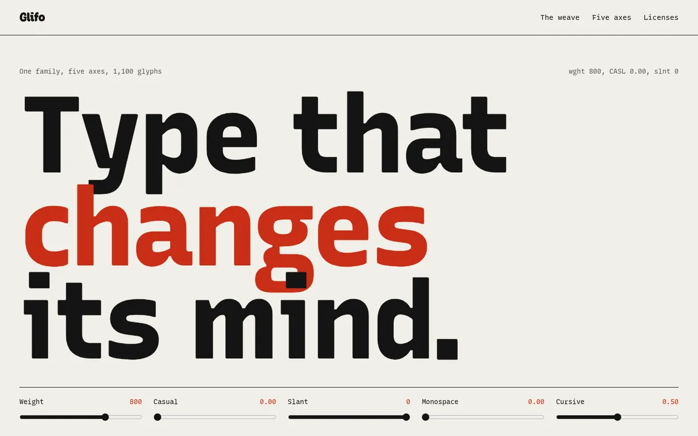</a></td>
<td width="28%" valign="top"><a href="https://acf1210.github.io/bureau/showcase/foundry/index.html">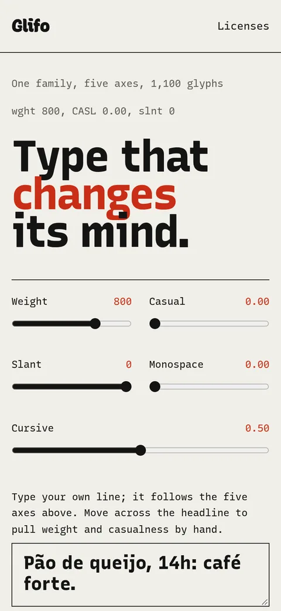</a></td>
</tr>
<tr>
<td colspan="2"><b>Glifo</b> · Type foundry · <sub>A. Albers × Scher × Cooper</sub><br>Pull five axes by hand, weave a field of letters, open one in depth. <a href="https://acf1210.github.io/bureau/showcase/foundry/index.html">Open ↗</a></td>
</tr>
</table>
<!-- gallery:end -->

Each model is one page with its own CSS and JS. The floor still holds: real contrast, a keyboard path, reduced motion designed as a still, all copy readable without JavaScript, and no button that pretends to send. Studios, people and prices are fictional and labelled. The 13 scaffold templates remain in the skill (`new-project.mjs --list`).

---

## How it works

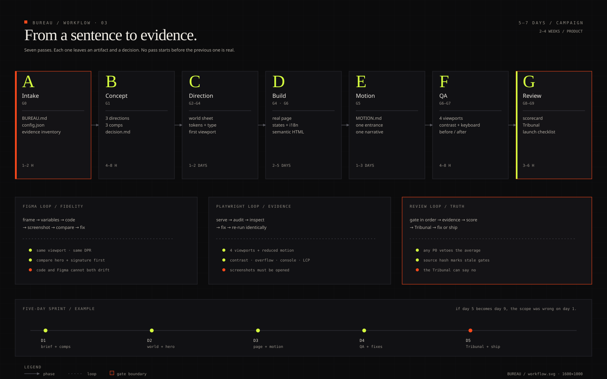

1. **Intake.** Product truth goes into `BUREAU.md`: audience, offer, sourced proof, non-goals.
2. **Concept.** First a survey of five verified references from the 25 sources (a source that cannot be verified is skipped and the next one taken), naming the shared pattern and the departure. Then three directions, each a blend of three lineages. The chosen one goes into `blend.md`.
3. **Direction.** `DESIGN.md` with normative tokens, ENERGY / RHYTHM / MOTION dials and the visual world.
4. **Build and refinement.** Seven passes, from structure to detail, each with evidence.
5. **QA and review.** Static audit, visual audit at five widths, ten gates, the Delivery Gate and the Tribunal.

[Full workflow →](docs/en/workflow.md)

---

## The circuit

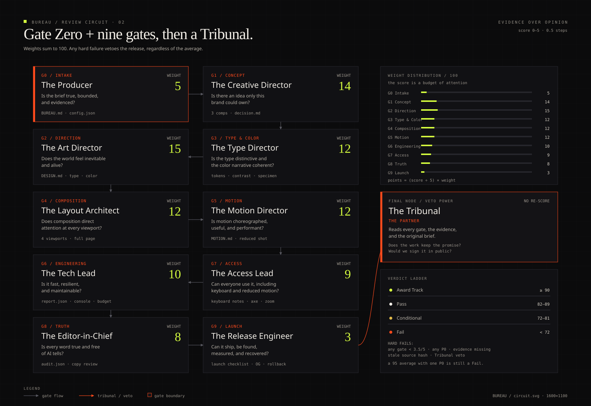

| Verdict | Score |
|---|---:|
| Award Track | ≥ 90 |
| Pass | 82–89 |
| Conditional | 72–81 |
| Fail | < 72 |

Any P0, any gate under 3.5/5, missing evidence, source changed after review, or an unclean Delivery Gate **fails**. A 95 with one accessibility P0 is a Fail. A Tribunal run in the same context that built the work is declared *degraded* and cannot reach Award. The jury loop is capped at 10 minutes: jurors vote in parallel, each round is scored, and the best round inside the window is the decision.

[Read the full circuit →](docs/en/review-circuit.md)

---

## Anti-AI-slop

| Tier | Severity | Waiver |
|---|---|---|
| **Floor** | P0 | never |
| **Reflex** | P1 | rule ID + a reason of 20+ characters about this page |
| **Finish** | P2 | answered, never blocks |

```bash
node skill/scripts/audit.mjs .                 # 32 regex rules + project checks
node skill/scripts/visual-audit.mjs http://localhost:4173 --out .bureau/qa
node skill/scripts/divergence.mjs index.html --templates
```

The detector catches the mechanical subset: purple gradients, fake sends, dead links, content hidden without JS, template punctuation, default fonts, autoplay and more. Every rule has a failing and a passing test. A clean audit is not quality: with no dials and no world, the page is a clean void and fails Gates 1 and 2.

[Anti-slop taxonomy →](docs/en/antislop.md)

---

## Lineage and blend

No direction comes from one source. The canon holds forty designers cited by documented work, from Müller-Brockmann and Tschichold to Lina Bo Bardi, Reid Miles and Susan Kare. Each blend uses a **dominant** (50–60%, structure), a **counter** (25–35%, expression, pulling against it) and an **accent** (10–20%, one behaviour), plus one ingredient only the subject has.

[Lineage and blend →](docs/en/design-language.md)

---

## Install

```bash
git clone https://github.com/acf1210/bureau.git
cd bureau

# always preview first
bash installers/install.sh --agent all --scope user --dry-run

# install
bash installers/install.sh --agent all --scope user
```

Windows:

```powershell
powershell -ExecutionPolicy Bypass -File installers/install.ps1 -Agent all -Scope user -DryRun
powershell -ExecutionPolicy Bypass -File installers/install.ps1 -Agent all -Scope user
```

Restart the agent and call `/bureau`, or ask naturally: *"Use BUREAU to build my brand's site."*

| Host | Skill | Extra |
|---|---|---|
| Claude Code | `~/.claude/skills/bureau` | `~/.claude/commands/bureau.md` |
| Codex | `~/.codex/skills/bureau` | optional block in `AGENTS.md` |
| Antigravity | `~/.gemini/config/skills/bureau` | `model_decision` rule |
| Hermes | `~/.hermes/skills/creative/bureau` | — |

[Full install guide →](docs/en/install.md)

---

## First use

```bash
node skill/scripts/doctor.mjs
node skill/scripts/new-project.mjs --list
node skill/scripts/new-project.mjs my-site --template restaurant-table
cd my-site

node ../skill/scripts/audit.mjs . --out .bureau/evidence/audit.json
node ../skill/scripts/visual-audit.mjs http://localhost:4173 --out .bureau/qa --full --motion
node ../skill/scripts/review.mjs --status
```

The scaffold writes `BUREAU.md`, `DESIGN.md` (with lineage and dials), `MOTION.md`, `.bureau/config.json` and the evidence folders. The page starts as a copy of the template: before Gate 2 it must diverge from it.

[The first 15 minutes →](docs/en/quickstart.md)

---

## Commands

| Command | Does |
|---|---|
| `/bureau` | contextual router |
| `/bureau auto` | full pipeline with three checkpoints |
| `/bureau init` | brief, config, evidence inventory |
| `/bureau concept` | three directions, three blends, one decision |
| `/bureau direction` | visual world, tokens, type, dials |
| `/bureau build` | implementation and refinement passes |
| `/bureau motion` | motion grammar and signature |
| `/bureau figma` | Figma → code |
| `/bureau qa` | screenshots, contrast, fold, console, performance |
| `/bureau review` | ten gates, Delivery Gate and Tribunal |
| `/bureau slop` | detector + fixes |
| `/bureau ship` | metadata, analytics, monitoring, rollback |
| `/bureau doctor` | environment and install |

[Command reference →](docs/en/commands.md)

---

## What is included

| Layer | Contents |
|---|---|
| **Skill** | `SKILL.md` with doctrine, autonomy contract, router, hard rules and tool protocol |
| **Depth** | 31 references, from concept and art direction to lineage and blend and refinement passes |
| **Scripts** | anti-slop audit, Playwright visual audit, divergence, five-source reference survey, stateful review circuit with a 10-minute jury, tokens, Figma sync, doctor, scaffold |
| **ShowCase** | 5 web models with their own phone composition, design first, each with a `LINEAGE.md` |
| **Templates** | 13 scaffold worlds for `new-project.mjs`, each with a `LINEAGE.md` |
| **Assets** | DTCG tokens, motion snippets, generated media, SVG diagrams |
| **Docs** | 9 pages × 3 languages (PT-BR, EN, ES) |
| **Tests** | 40 `node --test` tests, with fixtures in both directions for every rule |
| **Installers** | Claude Code, Codex, Antigravity, Hermes; bash and PowerShell |

---

## Structure

```
skill/                  the installable skill
  SKILL.md              router + doctrine + contract
  references/           33 modules
  scripts/              audit, visual-audit, divergence, survey, review, tokens, figma-sync, doctor, scaffold
  assets/templates/     13 templates + catalog.json
installers/             Claude, Codex, Antigravity, Hermes + bash/PowerShell
docs/                   PT-BR, EN, ES
  assets/diagrams/      architecture, circuit, workflow, anti-slop
showcase/               5 web models with mobile, design first
site/                   landing and static docs
scripts/                build-docs, capture-demos, gallery, og, serve
tests/                  node --test
```

---

## References and credits

BUREAU is an original work. It references publicly, without reproducing text:

- [Impeccable](https://impeccable.style), [Hallmark](https://github.com/Nutlope/hallmark), [antislop](https://github.com/miqdadbadjuber/anti-slop) and [Diagram Design](https://github.com/cathrynlavery/diagram-design): detection methods, binding tiers, the Delivery Gate, isolated critique;
- the forty designers of the canon, cited by work in `skill/references/23-lineage-and-blend.md`;
- [Colorfigures](https://april-zhu.com/colorfigures), [daoho.dev](https://daoho.dev), [Font Awesome](https://github.com/FortAwesome/Font-Awesome) and the galleries of the reference library.

PANTONE® is a trademark of Pantone LLC. BUREAU is not affiliated; hex values are screen approximations. Template fonts come from Google Fonts under the OFL. The film loop was generated for this repository.

MIT. See [LICENSE](LICENSE) and [NOTICE](NOTICE.md).
