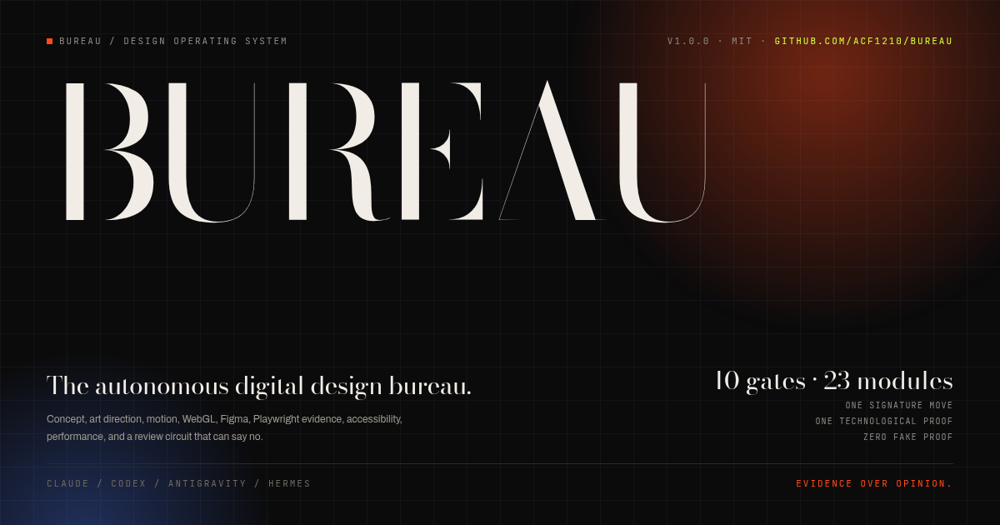

# BUREAU

**El bureau de diseño digital autónomo.** Una skill de agente que convierte un modelo de lenguaje en dirección creativa, dirección de arte, motion design, creative technology, accesibilidad, rendimiento y revisión adversarial.

[Português](README.md) · [English](README.en.md) · [Español](README.es.md) · [Docs](https://acf1210.github.io/bureau/es/index.html)



---

## El problema

Los modelos se entrenan con el promedio de internet. Sin dirección producen el mismo hero centrado, el mismo degradado morado, las mismas tres tarjetas con iconos y el mismo copy vacío. No es un problema de CSS. Es falta de **concepto, especificidad y revisión**.

- **Concepto antes que píxeles.** Tres direcciones distintas, una elección argumentada, un *signature move*.
- **Oficio verificable.** Tipografía, color, composición, motion, accesibilidad y rendimiento con rúbricas explícitas.
- **Revisión adversarial.** Diez puertas independientes y un Tribunal con poder de veto.
- **Cero fabricación.** Métricas, logos, testimonios o premios sin fuente son P0.

---

## El circuito

```
G0 Intake → G1 Concept → G2 Direction → G3 Type & Color → G4 Composition
→ G5 Motion → G6 Engineering → G7 Access → G8 Truth → G9 Launch → TRIBUNAL
```

| Veredicto | Nota |
|---|---:|
| Award Track | ≥ 90 |
| Pass | 82–89 |
| Conditional | 72–81 |
| Fail | < 72 |

Cualquier P0, cualquier puerta por debajo de 3,5/5, evidencia ausente o fuente modificada después de la revisión **rechaza la entrega**. Un 95 con un P0 de accesibilidad es Fail.

[Leer el circuito →](docs/es/review-circuit.md)

---

## Incluye

| Capa | Contenido |
|---|---|
| **Skill** | doctrina, contrato de autonomía, router, reglas duras, protocolo de herramientas |
| **Profundidad** | 23 referencias: concepto, dirección, tipografía, Pantone/OKLCH, layout, motion, WebGL, vídeo, imagen, interacción, accesibilidad, rendimiento, Figma, Playwright, circuito, anti-slop, copy, stack, referencias, ship, instaladores |
| **Scripts** | detector anti-slop, auditoría visual Playwright, circuito con estado, generador de tokens, sync Figma, doctor, scaffold |
| **Templates** | 3 proyectos autónomos: editorial cinético, superficie de producto con demo viva, experiencia WebGL |
| **Assets** | tokens DTCG, snippets de motion, media generada, diagramas SVG detallados |
| **Docs** | 9 páginas × 3 idiomas (PT-BR, EN, ES) |
| **Installers** | Claude Code, Codex, Antigravity, Hermes; bash y PowerShell |

---

## Instalación

```bash
git clone https://github.com/acf1210/bureau.git
cd bureau
bash installers/install.sh --agent all --scope user --dry-run
bash installers/install.sh --agent all --scope user
```

Windows:

```powershell
powershell -ExecutionPolicy Bypass -File installers/install.ps1 -Agent all -Scope user -DryRun
powershell -ExecutionPolicy Bypass -File installers/install.ps1 -Agent all -Scope user
```

Reinicia el agente y ejecuta `/bureau`, o pide naturalmente: *"Usa BUREAU para diseñar el sitio de mi marca."*

[Guía de instalación →](docs/es/install.md)

---

## Primer uso

```bash
node skill/scripts/doctor.mjs
node skill/scripts/new-project.mjs mi-sitio --template kinetic-editorial
cd mi-sitio

node ../skill/scripts/audit.mjs . --out .bureau/evidence/audit.json
node ../skill/scripts/visual-audit.mjs http://localhost:4173 --out .bureau/qa --full --motion
node ../skill/scripts/review.mjs --status
```

[Primeros 15 minutos →](docs/es/quickstart.md)

---

## Demos

| Demo | Qué demuestra |
|---|---|
| [Kinetic Editorial](https://acf1210.github.io/bureau/demos/kinetic-editorial/index.html) | tipografía editorial, índice como argumento, narrativa de scroll, vídeo, rail de tiempo |
| [Product Surface](https://acf1210.github.io/bureau/demos/product-surface/index.html) | producto técnico, modelo de escenario vivo, SVG, formulario, motion preciso |
| [Immersive Experience](https://acf1210.github.io/bureau/demos/immersive-experience/index.html) | WebGL crudo, respuesta al puntero, paleta por fase, fallback estático |

---

## Comandos

`/bureau` `init` `concept` `direction` `build` `motion` `figma` `qa` `review` `slop` `ship` `doctor`

[Referencia de comandos →](docs/es/commands.md)

---

## Anti-AI-slop

El detector cubre el subconjunto mecánico: degradado morado, texto en degradado, fondo puro, fuentes por defecto, léxico genérico, lorem ipsum, placeholders, autoplay, overflow de accesibilidad, `transition: all`, scroll hijack, `div onclick` y más.

```bash
node skill/scripts/audit.mjs .
node skill/scripts/audit.mjs . --fail-on p0
node skill/scripts/audit.mjs --list-rules
```

No juzga talento, composición ni verdad. Para eso está el circuito.

[Taxonomía →](docs/es/antislop.md)

---

## Estructura

```
skill/                  skill instalable
  SKILL.md              router + doctrina + contrato
  references/           23 módulos
  scripts/              audit, visual-audit, review, tokens, figma-sync, doctor, scaffold
  assets/               templates, tokens, snippets, media, diagramas
installers/             Claude, Codex, Antigravity, Hermes + bash/PowerShell
docs/                   PT-BR, EN, ES
  assets/diagrams/      arquitectura, circuito, workflow, anti-slop
site/                   landing y docs estáticos
scripts/                build-docs, capture-demos, og, serve
tests/                  node --test
```

---

## Créditos

BUREAU es original. Referencia públicamente [Impeccable](https://github.com/pbakaus/impeccable), [Colorfigures](https://april-zhu.com/colorfigures), [Font Awesome](https://github.com/FortAwesome/Font-Awesome) y las galerías de `skill/references/20-reference-library.md`.

PANTONE® es una marca de Pantone LLC. BUREAU no está afiliado; los valores hex son aproximaciones de pantalla. Archivo, Bodoni Moda y JetBrains Mono son OFL. El loop de vídeo fue generado para este repositorio.

MIT. Ver [LICENSE](LICENSE) y [NOTICE](NOTICE.md).
