# BUREAU

**O bureau de design digital autônomo.** Uma skill de agente que dá a um modelo de linguagem o trabalho de um estúdio inteiro: direção de criação, direção de arte, tipografia, motion, creative technology, acessibilidade, performance e uma revisão adversarial que diz *não*.

[](VERSION)
[](LICENSE)
[](#galeria)
[](#instalação)

[Português](README.md) · [English](README.en.md) · [Español](README.es.md) · [Documentação](https://acf1210.github.io/bureau/pt-BR/index.html) · [Demos ao vivo](https://acf1210.github.io/bureau/#demos)


---

## O problema

Modelos aprendem a média da internet. Sem direção, entregam o mesmo hero centralizado, o mesmo gradiente roxo, os mesmos três cards com ícone e a mesma copy vazia. Isso não se resolve com CSS. Falta **conceito, especificidade e revisão**.

- **Conceito antes de pixels.** Três direções distintas, uma escolha argumentada, um *signature move*.
- **Nunca uma fonte só.** Toda direção é uma mescla de três designers documentados, cada um dono de um eixo.
- **Ofício verificável.** Tipografia, cor, composição, motion, acessibilidade e performance com limites explícitos e scripts que medem.
- **Revisão adversarial.** Dez portões, um Delivery Gate com evidência em cada linha e um Tribunal com poder de veto.
- **Zero fabricação.** Métrica, logo, depoimento, prêmio ou "enviado com sucesso" sem verdade por trás é P0.

---

## Galeria

Treze templates, treze mundos, nenhum parecido com outro: o par mais próximo compartilha menos de 0,2 do fingerprint de design (`divergence.mjs`). Cada um tem uma composição mobile desenhada, não empilhada, e um `LINEAGE.md` com a sua mescla.

<!-- gallery:start -->
<table>
<tr>
<td width="33%" valign="top"><a href="https://acf1210.github.io/bureau/demos/kinetic-editorial/index.html">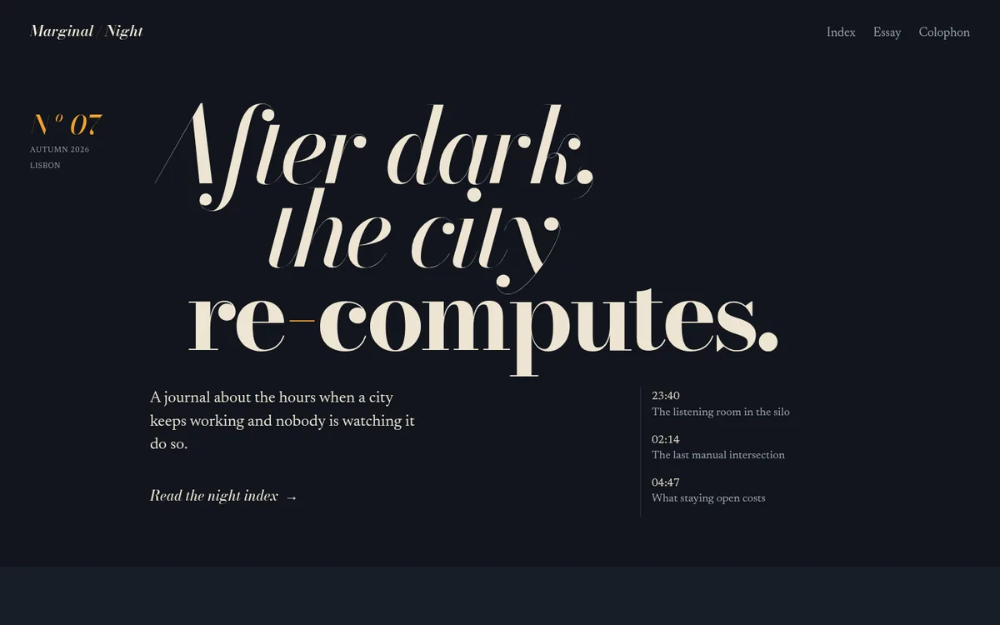</a><br><a href="https://acf1210.github.io/bureau/demos/kinetic-editorial/index.html">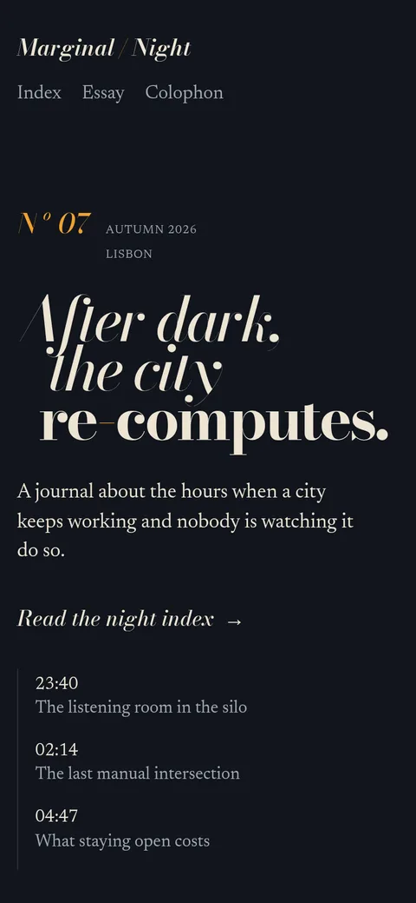</a><br><b>Kinetic Editorial</b><br><sub>Revista noturna · Tschichold × Lubalin × Bass</sub><br><sub>Um índice organizado pela hora de Lisboa ao vivo. <a href="https://acf1210.github.io/bureau/demos/kinetic-editorial/index.html">Abrir ↗</a></sub></td>
<td width="33%" valign="top"><a href="https://acf1210.github.io/bureau/demos/product-surface/index.html">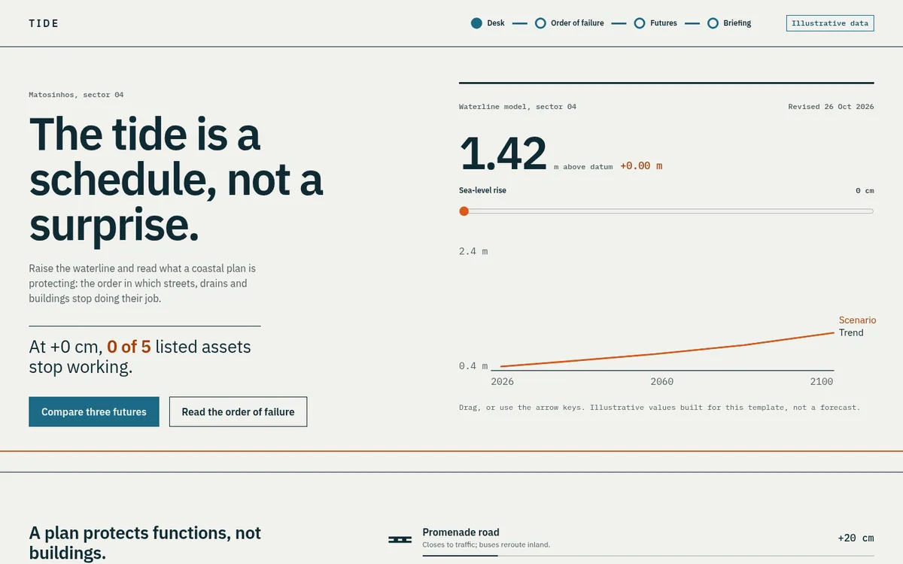</a><br><a href="https://acf1210.github.io/bureau/demos/product-surface/index.html">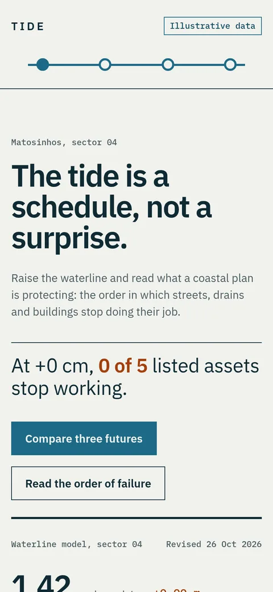</a><br><b>Product Surface</b><br><sub>Mesa de planejamento · Tufte × Vignelli × Aicher</sub><br><sub>Suba a linha d'água; a ordem de falha acompanha. <a href="https://acf1210.github.io/bureau/demos/product-surface/index.html">Abrir ↗</a></sub></td>
<td width="33%" valign="top"><a href="https://acf1210.github.io/bureau/demos/immersive-experience/index.html">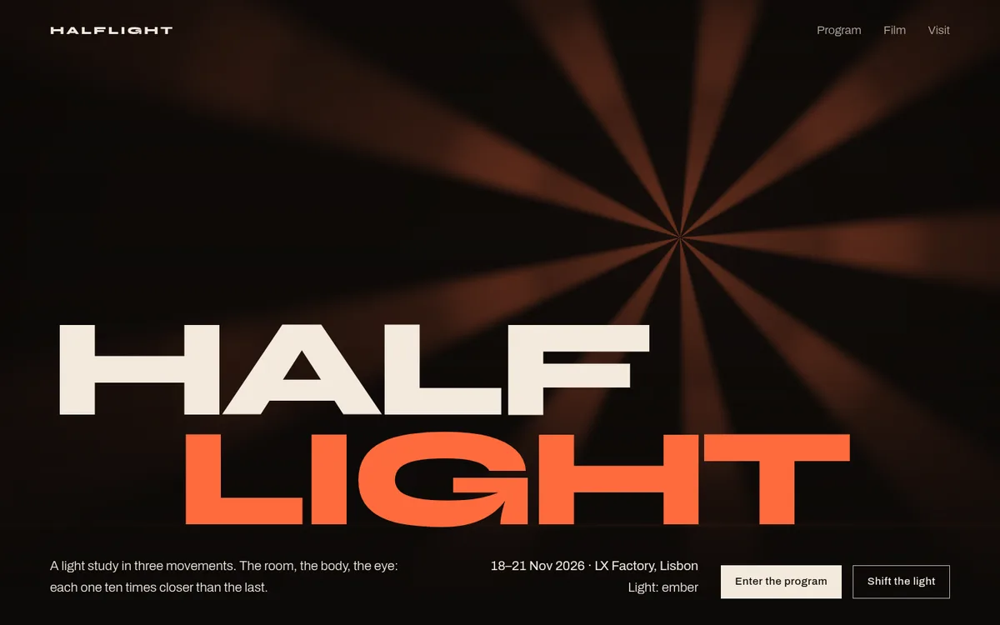</a><br><a href="https://acf1210.github.io/bureau/demos/immersive-experience/index.html">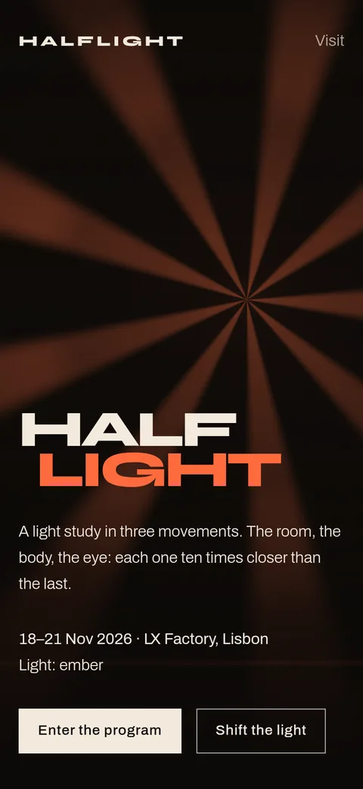</a><br><b>Immersive Experience</b><br><sub>Instalação de luz · Moholy-Nagy × Cooper × Eames</sub><br><sub>Mude a luz; shader, título e foco acompanham. <a href="https://acf1210.github.io/bureau/demos/immersive-experience/index.html">Abrir ↗</a></sub></td>
</tr>
<tr>
<td width="33%" valign="top"><a href="https://acf1210.github.io/bureau/demos/legal-practice/index.html">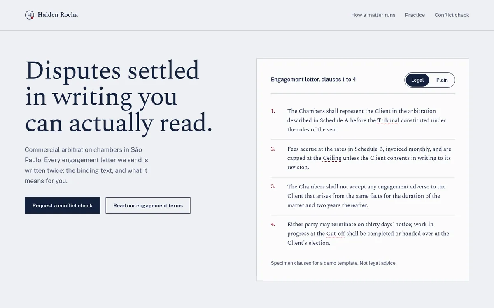</a><br><a href="https://acf1210.github.io/bureau/demos/legal-practice/index.html">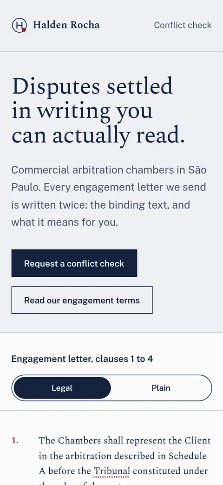</a><br><b>Legal Practice</b><br><sub>Câmara de arbitragem · Sutnar × Rand × Ruder</sub><br><sub>Cada cláusula em dois registros: jurídico e simples. <a href="https://acf1210.github.io/bureau/demos/legal-practice/index.html">Abrir ↗</a></sub></td>
<td width="33%" valign="top"><a href="https://acf1210.github.io/bureau/demos/architecture-studio/index.html">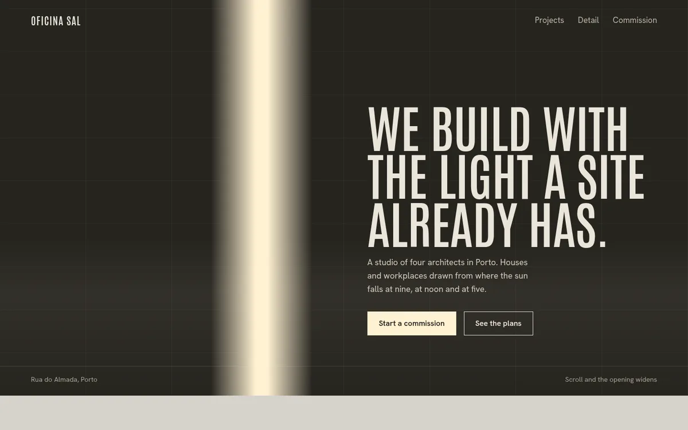</a><br><a href="https://acf1210.github.io/bureau/demos/architecture-studio/index.html">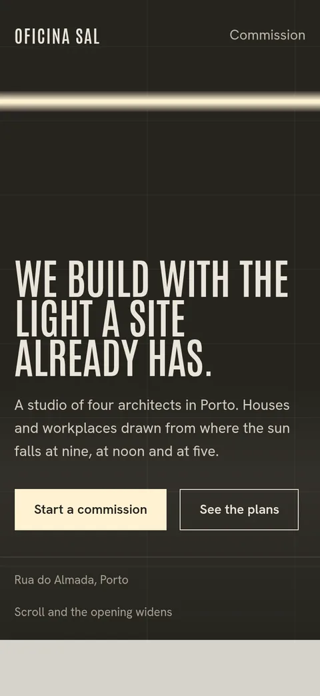</a><br><b>Architecture Studio</b><br><sub>Estúdio de arquitetura · Ando × Mies × Scarpa</sub><br><sub>Uma fenda de luz que se abre com o scroll. <a href="https://acf1210.github.io/bureau/demos/architecture-studio/index.html">Abrir ↗</a></sub></td>
<td width="33%" valign="top"><a href="https://acf1210.github.io/bureau/demos/restaurant-table/index.html">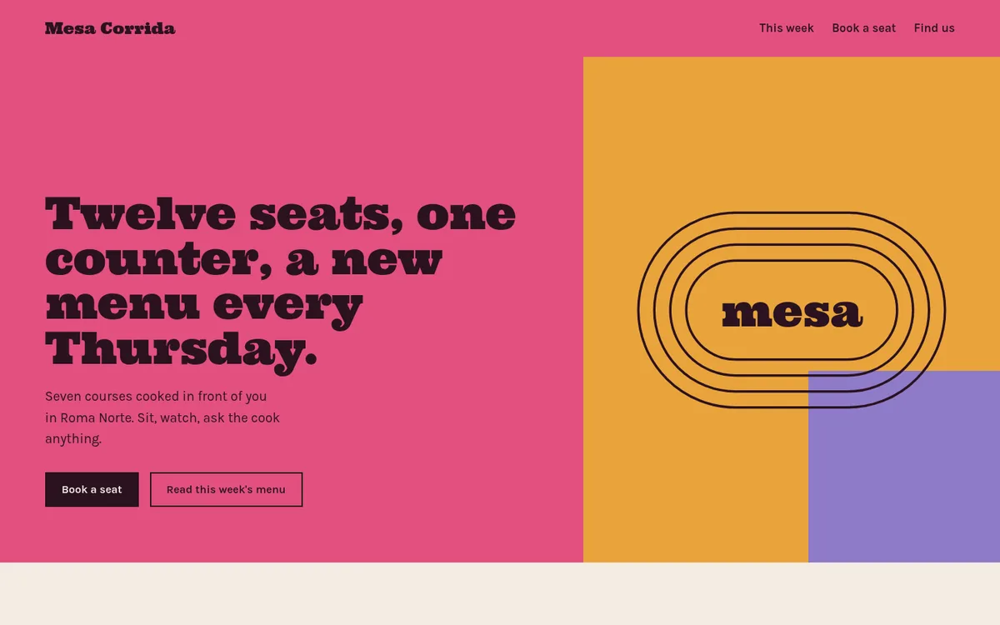</a><br><a href="https://acf1210.github.io/bureau/demos/restaurant-table/index.html">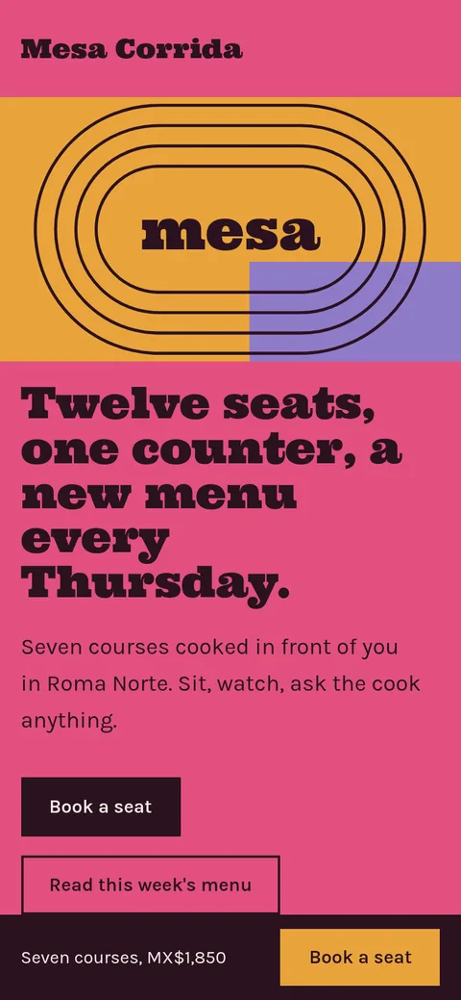</a><br><b>Restaurant Table</b><br><sub>Balcão de degustação · Barragán × Wyman × J. Albers</sub><br><sub>Escolha seus lugares no arco do balcão. <a href="https://acf1210.github.io/bureau/demos/restaurant-table/index.html">Abrir ↗</a></sub></td>
</tr>
<tr>
<td width="33%" valign="top"><a href="https://acf1210.github.io/bureau/demos/private-bank/index.html">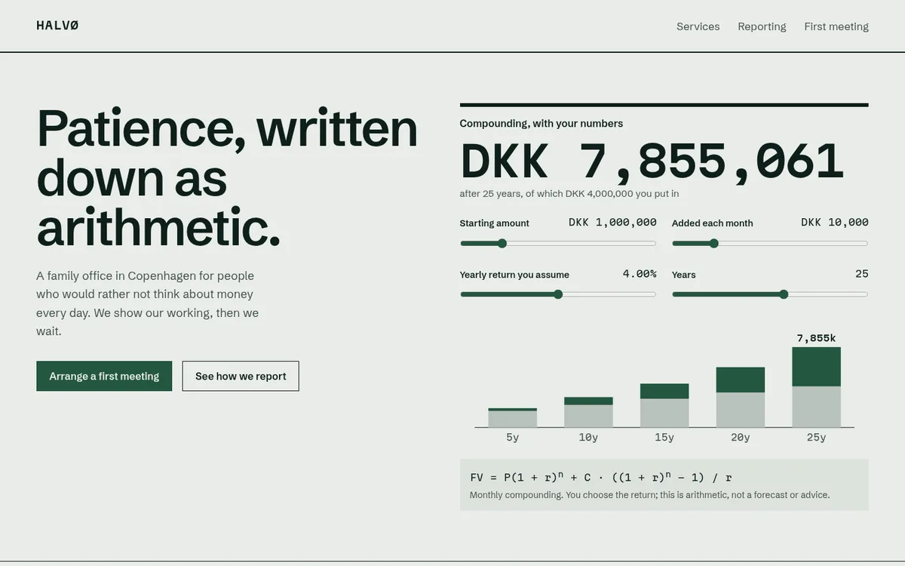</a><br><a href="https://acf1210.github.io/bureau/demos/private-bank/index.html">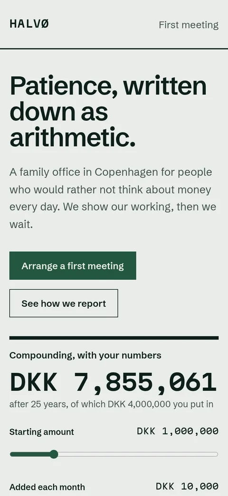</a><br><b>Private Bank</b><br><sub>Family office · Müller-Brockmann × Crouwel × Tufte</sub><br><sub>Juros compostos com seus números, fórmula à vista. <a href="https://acf1210.github.io/bureau/demos/private-bank/index.html">Abrir ↗</a></sub></td>
<td width="33%" valign="top"><a href="https://acf1210.github.io/bureau/demos/clinic-care/index.html">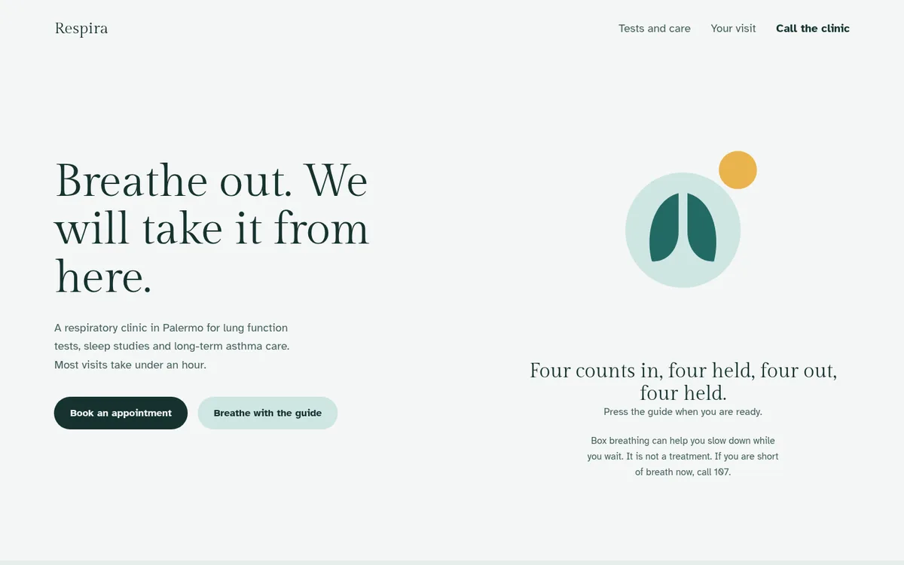</a><br><a href="https://acf1210.github.io/bureau/demos/clinic-care/index.html">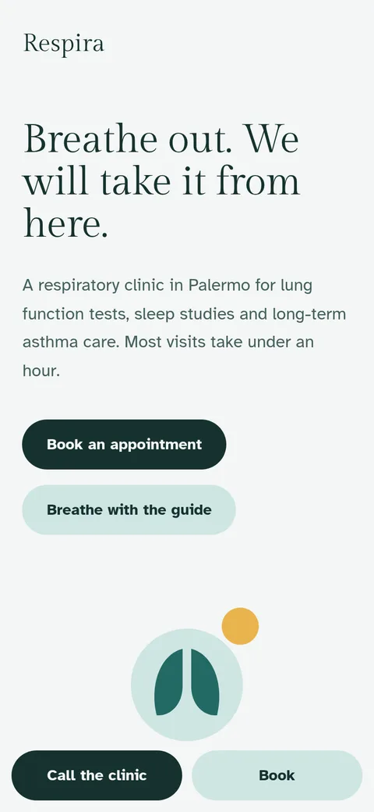</a><br><b>Clinic Care</b><br><sub>Clínica respiratória · Hara × Kare × Tanaka</sub><br><sub>Um guia de respiração que só começa quando você aperta. <a href="https://acf1210.github.io/bureau/demos/clinic-care/index.html">Abrir ↗</a></sub></td>
<td width="33%" valign="top"><a href="https://acf1210.github.io/bureau/demos/developer-api/index.html">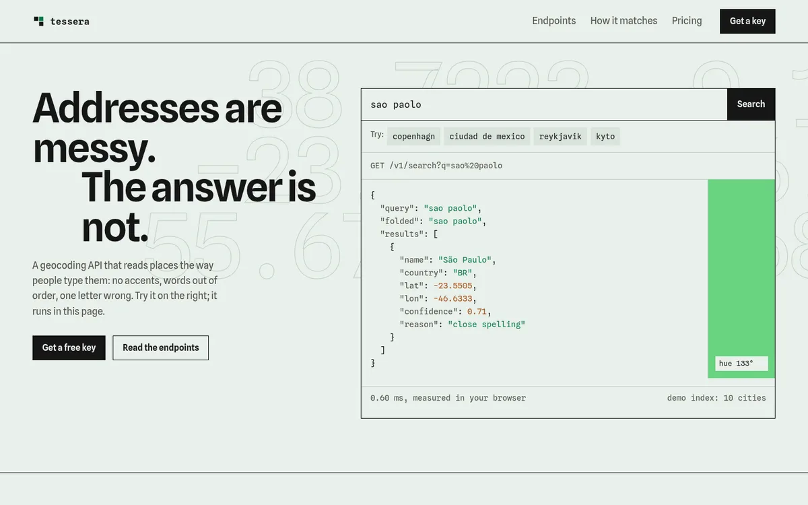</a><br><a href="https://acf1210.github.io/bureau/demos/developer-api/index.html">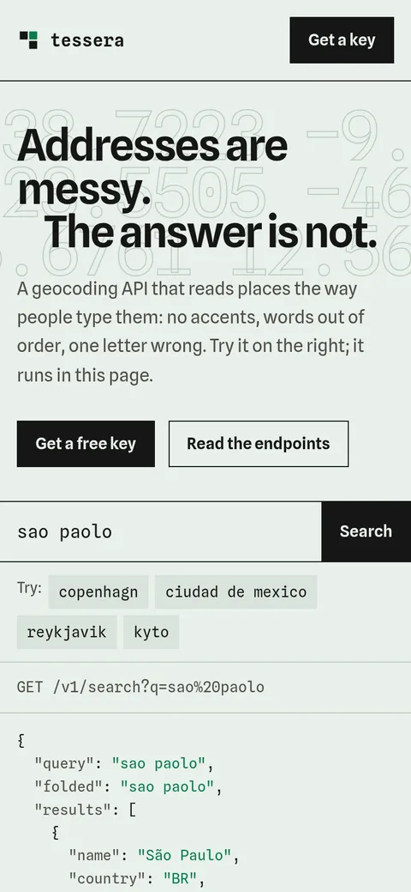</a><br><b>Developer API</b><br><sub>API de geocodificação · Gerstner × Weingart × Greiman</sub><br><sub>Um playground que casa erros de digitação de verdade. <a href="https://acf1210.github.io/bureau/demos/developer-api/index.html">Abrir ↗</a></sub></td>
</tr>
<tr>
<td width="33%" valign="top"><a href="https://acf1210.github.io/bureau/demos/fashion-atelier/index.html">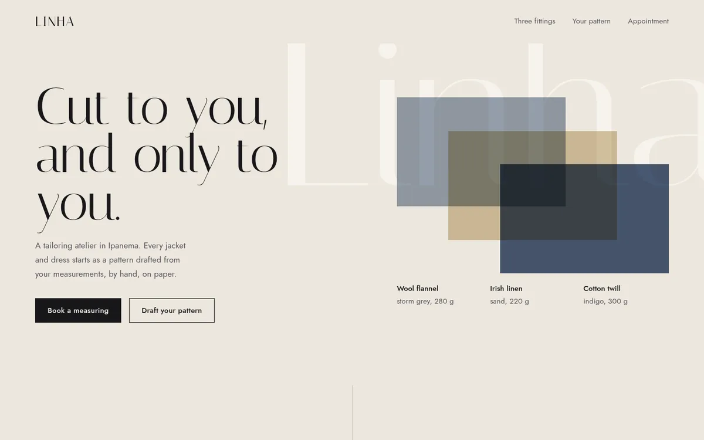</a><br><a href="https://acf1210.github.io/bureau/demos/fashion-atelier/index.html">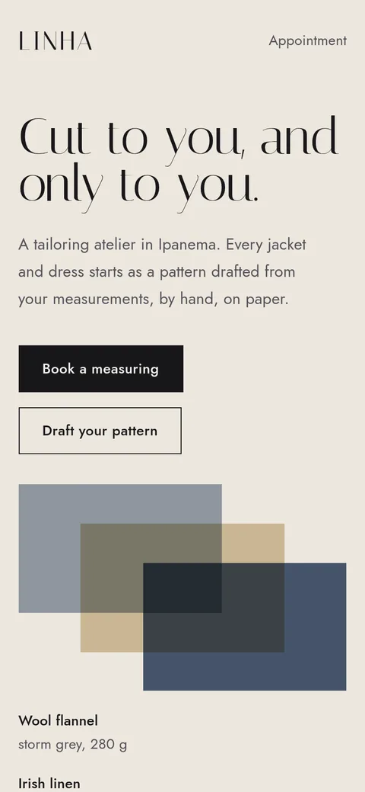</a><br><b>Fashion Atelier</b><br><sub>Alfaiataria sob medida · Brodovitch × A. Albers × B. Thompson</sub><br><sub>Um molde desenhado a partir das suas medidas. <a href="https://acf1210.github.io/bureau/demos/fashion-atelier/index.html">Abrir ↗</a></sub></td>
<td width="33%" valign="top"><a href="https://acf1210.github.io/bureau/demos/record-label/index.html">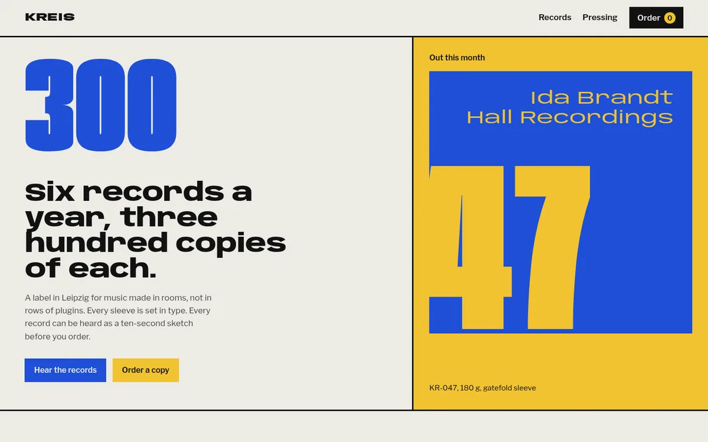</a><br><a href="https://acf1210.github.io/bureau/demos/record-label/index.html">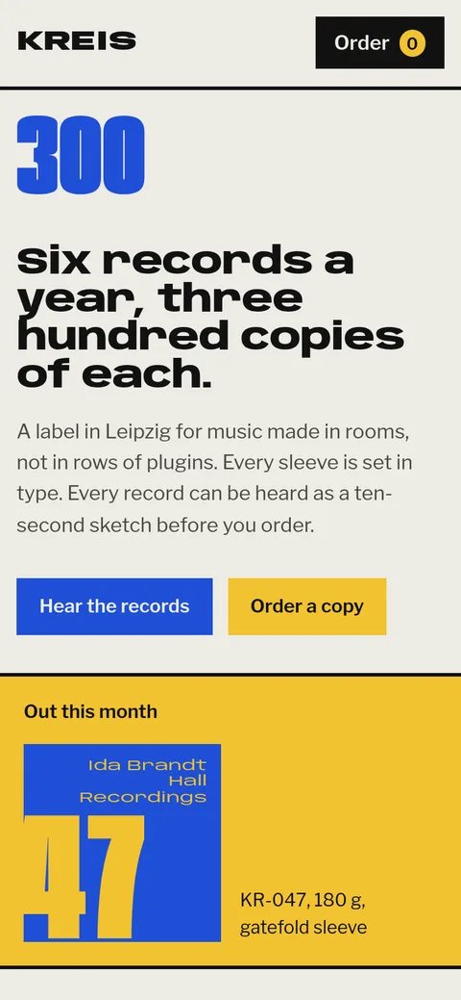</a><br><b>Record Label</b><br><sub>Selo de discos · Reid Miles × Saville × Brody</sub><br><sub>Capas só de tipo que tocam um esboço sintetizado. <a href="https://acf1210.github.io/bureau/demos/record-label/index.html">Abrir ↗</a></sub></td>
<td width="33%" valign="top"><a href="https://acf1210.github.io/bureau/demos/museum-archive/index.html">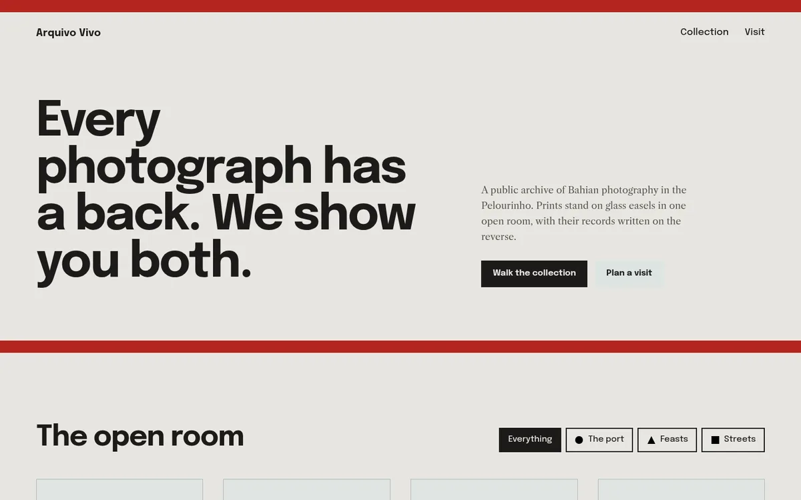</a><br><a href="https://acf1210.github.io/bureau/demos/museum-archive/index.html">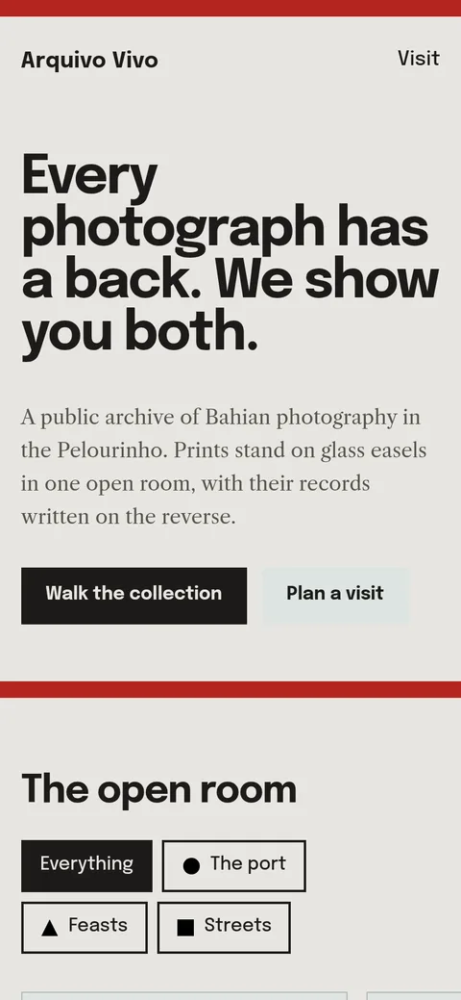</a><br><b>Museum Archive</b><br><sub>Arquivo fotográfico · Bo Bardi × Lustig × Munari</sub><br><sub>Cavaletes de vidro com a ficha no verso. <a href="https://acf1210.github.io/bureau/demos/museum-archive/index.html">Abrir ↗</a></sub></td>
</tr>
<tr>
<td width="33%" valign="top"><a href="https://acf1210.github.io/bureau/demos/hardware-store/index.html">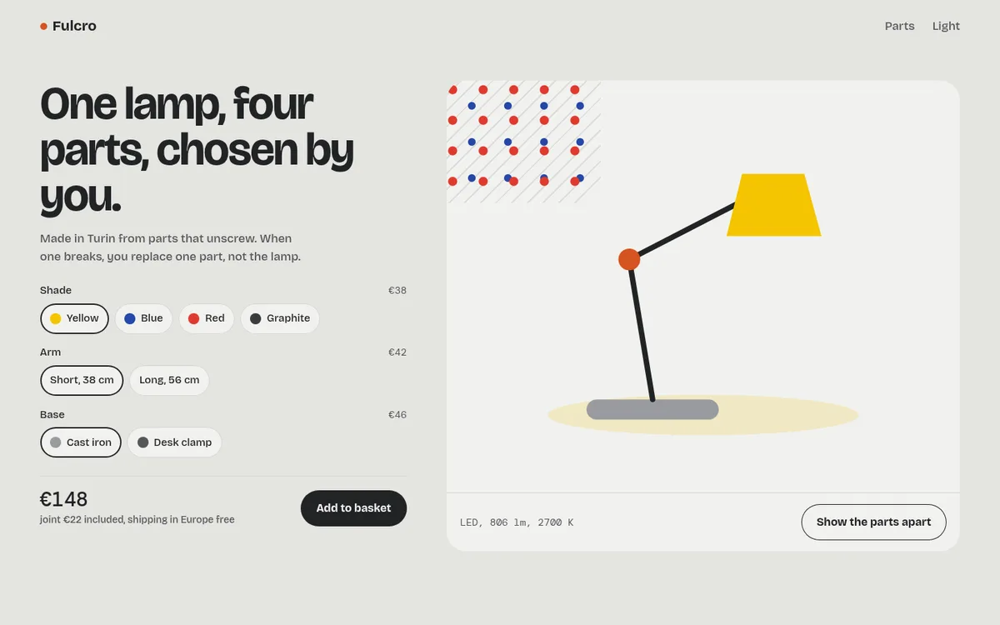</a><br><a href="https://acf1210.github.io/bureau/demos/hardware-store/index.html">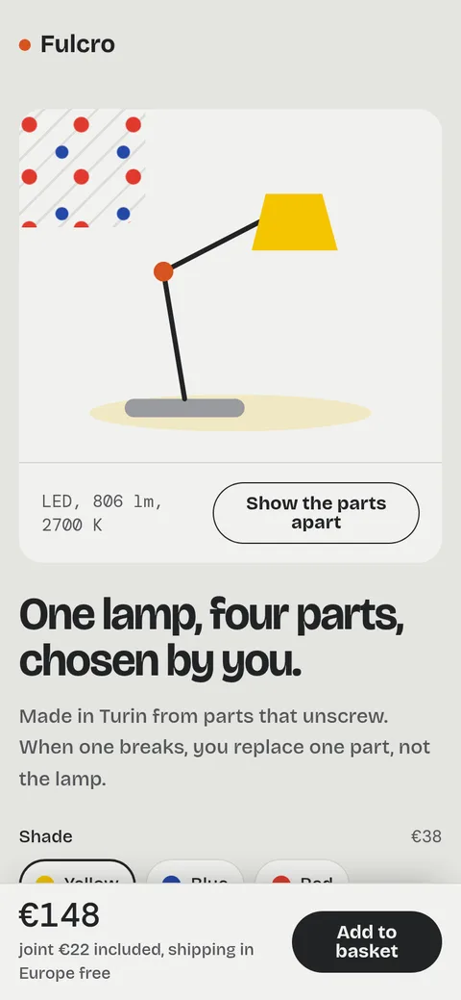</a><br><b>Hardware Store</b><br><sub>Loja de produto · Rams × Sottsass × Castiglioni</sub><br><sub>Configure a luminária e veja as peças, com preço. <a href="https://acf1210.github.io/bureau/demos/hardware-store/index.html">Abrir ↗</a></sub></td>
</tr>
</table>

| Template | Tema | Mescla | Assinatura |
|---|---|---|---|
| [Kinetic Editorial](https://acf1210.github.io/bureau/demos/kinetic-editorial/index.html) | Revista noturna | Tschichold × Lubalin × Bass | Um índice organizado pela hora de Lisboa ao vivo |
| [Product Surface](https://acf1210.github.io/bureau/demos/product-surface/index.html) | Mesa de planejamento | Tufte × Vignelli × Aicher | Suba a linha d'água; a ordem de falha acompanha |
| [Immersive Experience](https://acf1210.github.io/bureau/demos/immersive-experience/index.html) | Instalação de luz | Moholy-Nagy × Cooper × Eames | Mude a luz; shader, título e foco acompanham |
| [Legal Practice](https://acf1210.github.io/bureau/demos/legal-practice/index.html) | Câmara de arbitragem | Sutnar × Rand × Ruder | Cada cláusula em dois registros: jurídico e simples |
| [Architecture Studio](https://acf1210.github.io/bureau/demos/architecture-studio/index.html) | Estúdio de arquitetura | Ando × Mies × Scarpa | Uma fenda de luz que se abre com o scroll |
| [Restaurant Table](https://acf1210.github.io/bureau/demos/restaurant-table/index.html) | Balcão de degustação | Barragán × Wyman × J. Albers | Escolha seus lugares no arco do balcão |
| [Private Bank](https://acf1210.github.io/bureau/demos/private-bank/index.html) | Family office | Müller-Brockmann × Crouwel × Tufte | Juros compostos com seus números, fórmula à vista |
| [Clinic Care](https://acf1210.github.io/bureau/demos/clinic-care/index.html) | Clínica respiratória | Hara × Kare × Tanaka | Um guia de respiração que só começa quando você aperta |
| [Developer API](https://acf1210.github.io/bureau/demos/developer-api/index.html) | API de geocodificação | Gerstner × Weingart × Greiman | Um playground que casa erros de digitação de verdade |
| [Fashion Atelier](https://acf1210.github.io/bureau/demos/fashion-atelier/index.html) | Alfaiataria sob medida | Brodovitch × A. Albers × B. Thompson | Um molde desenhado a partir das suas medidas |
| [Record Label](https://acf1210.github.io/bureau/demos/record-label/index.html) | Selo de discos | Reid Miles × Saville × Brody | Capas só de tipo que tocam um esboço sintetizado |
| [Museum Archive](https://acf1210.github.io/bureau/demos/museum-archive/index.html) | Arquivo fotográfico | Bo Bardi × Lustig × Munari | Cavaletes de vidro com a ficha no verso |
| [Hardware Store](https://acf1210.github.io/bureau/demos/hardware-store/index.html) | Loja de produto | Rams × Sottsass × Castiglioni | Configure a luminária e veja as peças, com preço |
<!-- gallery:end -->

Todos são autocontidos (HTML, CSS e JS num arquivo), passam no audit estático e visual sem P0 nem P1 em 320 a 1920 px, e usam fallbacks de fonte com métrica casada para não deslocar o layout. Pessoas, marcas, preços e dados são fictícios e rotulados.

---

## Como funciona


1. **Intake.** A verdade do produto vai para `BUREAU.md`: público, oferta, provas com fonte, não-objetivos.
2. **Conceito.** Três direções, cada uma com uma mescla de três linhagens. A escolhida vai para `blend.md`.
3. **Direção.** `DESIGN.md` com tokens normativos, dials ENERGY / RHYTHM / MOTION e o mundo visual.
4. **Build e refinamento.** Sete passes, da estrutura ao detalhe, cada um com evidência.
5. **QA e revisão.** Audit estático, audit visual em seis larguras, dez portões, Delivery Gate e Tribunal.

[Fluxo de trabalho completo →](docs/pt-BR/workflow.md)

---

## O circuito


| Veredito | Nota |
|---|---:|
| Award Track | ≥ 90 |
| Pass | 82–89 |
| Conditional | 72–81 |
| Fail | < 72 |

Qualquer P0, qualquer portão abaixo de 3,5/5, evidência ausente, fonte alterada depois da revisão ou um Delivery Gate sujo **reprova**. Um 95 com um P0 de acessibilidade é Fail. Um Tribunal no mesmo contexto que construiu o trabalho é declarado *degraded* e não chega a Award.

[Leia o circuito completo →](docs/pt-BR/review-circuit.md)

---

## Anti-AI-slop

| Nível | Severidade | Renúncia |
|---|---|---|
| **Floor** | P0 | nunca |
| **Reflex** | P1 | ID da regra + motivo de 20+ caracteres sobre esta página |
| **Finish** | P2 | respondido, nunca bloqueia |

```bash
node skill/scripts/audit.mjs .                 # 32 regras de regex + checagens de projeto
node skill/scripts/visual-audit.mjs http://localhost:4173 --out .bureau/qa
node skill/scripts/divergence.mjs index.html --templates
```

O detector pega o subconjunto mecânico: gradiente roxo, envio falso, link morto, conteúdo invisível sem JS, pontuação de template, fonte padrão, autoplay e mais. Toda regra tem um teste que falha e um que passa. Um audit limpo não é qualidade: sem dials e sem mundo, a página é um vazio limpo e reprova nos Gates 1 e 2.

[Taxonomia anti-slop →](docs/pt-BR/antislop.md)

---

## Linhagem e mescla

Nenhuma direção vem de uma fonte só. O cânone tem quarenta designers citados pela obra documentada, de Müller-Brockmann e Tschichold a Lina Bo Bardi, Reid Miles e Susan Kare. Cada mescla usa um **dominante** (50–60%, estrutura), um **contraponto** (25–35%, expressão, puxando contra) e um **acento** (10–20%, um comportamento), mais um ingrediente que só o assunto tem.

[Linhagem e mescla →](docs/pt-BR/design-language.md)

---

## Instalação

```bash
git clone https://github.com/acf1210/bureau.git
cd bureau

# sempre visualize primeiro
bash installers/install.sh --agent all --scope user --dry-run

# instale
bash installers/install.sh --agent all --scope user
```

Windows:

```powershell
powershell -ExecutionPolicy Bypass -File installers/install.ps1 -Agent all -Scope user -DryRun
powershell -ExecutionPolicy Bypass -File installers/install.ps1 -Agent all -Scope user
```

Reinicie o agente e invoque `/bureau` ou peça naturalmente: *"Use BUREAU para criar o site da minha marca."*

| Host | Skill | Extra |
|---|---|---|
| Claude Code | `~/.claude/skills/bureau` | `~/.claude/commands/bureau.md` |
| Codex | `~/.codex/skills/bureau` | bloco opcional em `AGENTS.md` |
| Antigravity | `~/.gemini/config/skills/bureau` | regra `model_decision` |
| Hermes | `~/.hermes/skills/creative/bureau` | — |

[Guia de instalação completo →](docs/pt-BR/install.md)

---

## Primeiro uso

```bash
node skill/scripts/doctor.mjs
node skill/scripts/new-project.mjs --list
node skill/scripts/new-project.mjs meu-site --template restaurant-table
cd meu-site

node ../skill/scripts/audit.mjs . --out .bureau/evidence/audit.json
node ../skill/scripts/visual-audit.mjs http://localhost:4173 --out .bureau/qa --full --motion
node ../skill/scripts/review.mjs --status
```

O scaffold cria `BUREAU.md`, `DESIGN.md` (com linhagem e dials), `MOTION.md`, `.bureau/config.json` e as pastas de evidência. A página começa como cópia do template: antes do Gate 2 ela precisa divergir dele.

[Primeiros 15 minutos →](docs/pt-BR/quickstart.md)

---

## Comandos

| Comando | Função |
|---|---|
| `/bureau` | roteador contextual |
| `/bureau auto` | pipeline completo com três checkpoints |
| `/bureau init` | brief, config, inventário de evidência |
| `/bureau concept` | três direções, três mesclas, uma decisão |
| `/bureau direction` | mundo visual, tokens, tipografia, dials |
| `/bureau build` | implementação e passes de refinamento |
| `/bureau motion` | gramática de movimento e assinatura |
| `/bureau figma` | Figma → código |
| `/bureau qa` | screenshots, contraste, dobra, console, performance |
| `/bureau review` | dez portões, Delivery Gate e Tribunal |
| `/bureau slop` | detector + correções |
| `/bureau ship` | metadata, analytics, monitoramento, rollback |
| `/bureau doctor` | ambiente e instalação |

[Referência de comandos →](docs/pt-BR/commands.md)

---

## O que está incluído

| Camada | Conteúdo |
|---|---|
| **Skill** | `SKILL.md` com doutrina, contrato de autonomia, roteador, regras duras e protocolo de ferramentas |
| **Profundidade** | 25 referências, de conceito e direção de arte a linhagem e mescla e passes de refinamento |
| **Scripts** | audit anti-slop, audit visual Playwright, divergência, circuito de revisão com estado, tokens, sync Figma, doctor, scaffold |
| **Templates** | 13 mundos com desktop e mobile desenhados, cada um com `LINEAGE.md` |
| **Assets** | tokens DTCG, snippets de motion, mídia gerada, diagramas SVG |
| **Docs** | 9 páginas × 3 idiomas (PT-BR, EN, ES) |
| **Testes** | 25 testes `node --test`, com fixtures nos dois sentidos para cada regra |
| **Installers** | Claude Code, Codex, Antigravity, Hermes; bash e PowerShell |

---

## Estrutura

```
skill/                  a skill instalável
  SKILL.md              roteador + doutrina + contrato
  references/           25 módulos
  scripts/              audit, visual-audit, divergence, review, tokens, figma-sync, doctor, scaffold
  assets/templates/     13 templates + catalog.json
installers/             Claude, Codex, Antigravity, Hermes + bash/PowerShell
docs/                   PT-BR, EN, ES
  assets/diagrams/      arquitetura, circuito, workflow, anti-slop
site/                   landing e docs estáticos
scripts/                build-docs, capture-demos, gallery, og, serve
tests/                  node --test
```

---

## Referências e créditos

BUREAU é um trabalho original. Ele referencia publicamente, sem reproduzir texto:

- [Impeccable](https://impeccable.style), [Hallmark](https://github.com/Nutlope/hallmark), [antislop](https://github.com/miqdadbadjuber/anti-slop) e [Diagram Design](https://github.com/cathrynlavery/diagram-design): métodos de detecção, níveis de vinculação, Delivery Gate, crítica isolada;
- os quarenta designers do cânone, citados pela obra em `skill/references/23-lineage-and-blend.md`;
- [Colorfigures](https://april-zhu.com/colorfigures), [daoho.dev](https://daoho.dev), [Font Awesome](https://github.com/FortAwesome/Font-Awesome) e as galerias da biblioteca de referência.

PANTONE® é marca da Pantone LLC. BUREAU não é afiliado; valores hexadecimais são aproximações para tela. As fontes dos templates vêm do Google Fonts, sob OFL. O loop de vídeo foi gerado para este repositório.

MIT. Veja [LICENSE](LICENSE) e [NOTICE](NOTICE.md).
