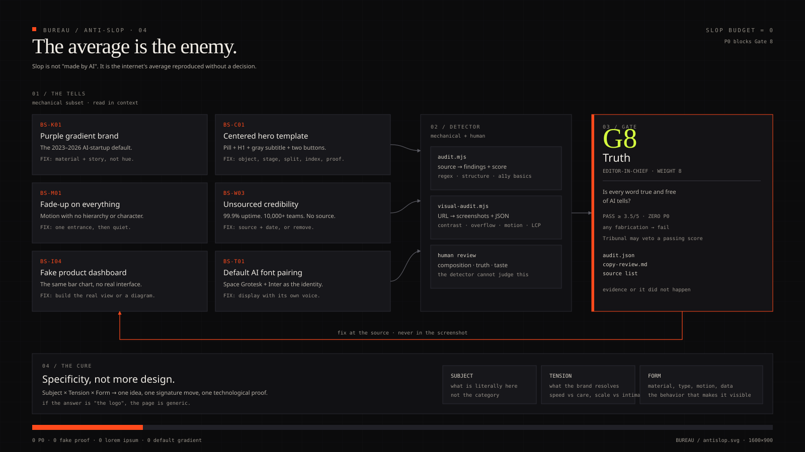

# Anti-AI-slop

Slop no es "hecho por IA". Es **la media de internet reproducida sin una decisión**. El antídoto no es más diseño; es especificidad.



## La prueba de tres segundos

Mostrar el primer viewport durante tres segundos. Preguntar:

1. ¿Esto podría ser cualquier startup de IA de 2023–2026?
2. ¿La marca es identificable sin el logo?
3. ¿Existe un elemento que solo podría pertenecer a este asunto?
4. ¿El copy dice algo falsable o específico?
5. ¿El motion hace un trabajo o solo interpreta "premium"?

Tres o más "no" → es slop, independientemente del pulido.

---

## Taxonomía

| ID | Señal | Corrección |
|---|---|---|
| **BS-C01** | hero centrado: pill + H1 + subtítulo gris + dos botones + degradado | elegir una composición: objeto, escenario, argumento dividido, índice o prueba en vivo |
| **BS-C02** | tres tarjetas iguales con icono | jerarquía, comparación, ledger, secuencia o una prueba profunda |
| **BS-C03** | secciones 01/02/03 sin secuencia real | numerar solo cuando el orden importa |
| **BS-C04** | bento por moda | usar solo si el contenido es modular y desigual |
| **BS-C05** | todas las secciones con la misma altura | mapa de densidad |
| **BS-C06** | tarjetas dentro de tarjetas | aplanar; usar líneas, espacio y tipografía |
| **BS-C07** | radio de 24px en todo | familia de radio ligada al mundo |
| **BS-C08** | todo centrado | columna dominante + peso asimétrico |
| **BS-C09** | footer con wordmark gigante + cuatro columnas | footer como argumento final |
| **BS-T01** | Space Grotesk + Inter | display con voz propia |
| **BS-T02** | display en la fuente estándar de UI | rol y face propios |
| **BS-T03** | micro-label en mayúsculas en cada sección | label solo cuando informa |
| **BS-T04** | cuerpo en 11–12px | 16px para prosa |
| **BS-T05** | 8 tamaños sin escala | usar la escala |
| **BS-T06** | texto en degradado | nunca |
| **BS-T07** | párrafo de 100ch | 65–75ch |
| **BS-K01** | degradado morado/índigo como marca | material e historia primero |
| **BS-K02** | degradado en el texto | nunca |
| **BS-K03** | #000 y #fff puros | matizar ambos |
| **BS-K04** | glass + glow + grain como receta | elegir un material |
| **BS-K05** | seis accents sin roles | 5–7 roles semánticos |
| **BS-K06** | accent 10× sobre el pliegue | ≤ 3 usos intencionales |
| **BS-M01** | fade-up en todo | una entrada, después silencio |
| **BS-M02** | `transition: all` | propiedades nombradas |
| **BS-M03** | hover scale 1.05 en cada tarjeta | una firma de interacción |
| **BS-M04** | loops infinitos sin pausa | un loop, pausa, reduced motion |
| **BS-M05** | parallax en todas las capas | una historia de profundidad |
| **BS-M06** | scroll hijack | sticky con scroll libre |
| **BS-M07** | reduced motion ignorado | modo diseñado |
| **BS-M08** | video con audio automático | mudo, inline, pausable |
| **BS-W01** | empower, seamless, elevate, unlock, supercharge | resultado concreto + número |
| **BS-W02** | lorem ipsum | nunca en producción |
| **BS-W03** | "99,9% uptime" sin fuente | enlace de la prueba o recorte |
| **BS-W04** | logoipsum / placeholder | asset licenciado y art-directed |
| **BS-W05** | testimonio con rostro de stock | testimonio real con consentimiento |
| **BS-W06** | "estamos emocionados de anunciar" | decir qué cambió y por qué |
| **BS-W07** | tres adjetivos seguidos | una afirmación + prueba |
| **BS-W08** | "Get started" en todo | nombrar la acción |
| **BS-W09** | copy que describe la categoría | describir el mecanismo y el resultado |
| **BS-W10** | emoji como bullet | icono con sistema |
| **BS-I01** | emoji como icono de producto | conjunto personalizado |
| **BS-I02** | Unsplash aleatorio | asset dirigido y licenciado |
| **BS-I03** | piel plástica, manos imposibles, texto falso | regenerar, recortar o componer |
| **BS-I04** | dashboard falso con el mismo gráfico | producto real o diagrama |
| **BS-I05** | logos de empresas inventadas | clientes reales con permiso |
| **BS-B01** | cursor nativo oculto | mantener el cursor |
| **BS-B02** | scroll del body bloqueado | solo en modal con escape |
| **BS-B04** | `div onclick` como botón | `<button>` |
| **BS-B05** | marquee sin pausa | pausa + reduced motion |
| **BS-E01** | `console.log` en producción | eliminar |
| **BS-E06** | sin viewport meta | añadir |
| **BS-E07** | sin `lang` | añadir el locale |
| **BS-E08** | imagen sin dimensiones | reservar espacio |

La taxonomía completa está en `skill/references/17-anti-ai-slop.md`.

---

## P0 — bloquean el G8

- **BS-K02** texto en degradado.
- **BS-W02** lorem ipsum.
- **BS-M07** reduced motion ignorado.
- **BS-M08 / BS-B08** audio automático.
- **BS-A01** imagen sin alt.
- **BS-A02** foco eliminado sin sustituto.
- **BS-A03** zoom desactivado.
- **BS-B04** div como botón.
- **BS-E06** sin viewport.
- Cualquier fabricación de prueba.

Un solo P0 define la página. No hay promedio que lo salve.

---

## Detector

```bash
node skill/scripts/audit.mjs .
node skill/scripts/audit.mjs . --json --out .bureau/evidence/audit.json
node skill/scripts/audit.mjs . --fail-on p0
node skill/scripts/audit.mjs --list-rules
```

El detector cubre lo mecánico. No juzga:

- composición;
- originalidad;
- verdad;
- talento;
- si la firma es memorable.

Para eso existe el circuito.

### Supresión

Solo suprimir un falso positivo probado:

```html
<!-- bureau-ignore BS-K01: degradado exigido por la marca, aprobado en DESIGN.md -->
```

El `audit.mjs` respeta la línea actual y la anterior, además de un encabezado `bureau-ignore-file`.

---

## Copy: léxico y sustitución

| Slop | Escribir |
|---|---|
| Empower your team | Dar al ops lead un cierre en 10 minutos |
| Seamless integration | Se sincroniza con HubSpot en un OAuth; sin CSV |
| Elevate your brand | Reconstruir la identidad en 6 semanas, con design system |
| Unlock insights | Ver qué 3 cuentas van a cancelar, hoy por la mañana |
| Supercharge workflows | Reducir la factura de 4 horas a 12 minutos |
| Next-generation platform | Corre en Postgres 16; deploy en 90 segundos |
| Cutting-edge AI | Un modelo de retrieval que cita el párrafo |
| Trusted by industry leaders | Logos reales + un caso con nombre |
| World-class support | Respuesta en 2 horas, lun–vie, por un ingeniero |

Reglas:

- una afirmación por frase;
- verbo > adjetivo;
- número con fuente;
- nombrar el mecanismo;
- leer en voz alta.

---

## La cura: especificidad

Preguntar en cada sección:

1. ¿Cuál es la única idea?
2. ¿Por qué este layout, y no el default?
3. ¿Cuál es la evidencia?
4. ¿Qué tendría que cambiar un competidor para usar esto?
5. ¿Qué saldría si recortáramos un 30%?

Si las respuestas son débiles, la sección no está lista.

---

## Excepciones

Una "señal" puede ser legítima cuando es el concepto:

- degradado morado para una marca cuyo tema es la luz sintética;
- tres tarjetas cuando hay tres opciones realmente iguales;
- tema oscuro, siempre que esté iluminado, no invertido;
- cursor personalizado, siempre que sea preciso, opcional y accesible;
- hero centrado, siempre que el tipo y el material lo sostengan.

La regla no es "nunca usar un patrón". Es **nunca usar sin una razón defendible en público**.

---

## Evidencia del G8

- `audit.json` sin P0 no resuelto.
- `copy-review.md` con afirmaciones y fuentes.
- screenshots de cada sección.
- lista de excepciones con razón.
- lectura final como un extraño.

El G8 pasa con **≥ 3,5/5** y cero P0.
